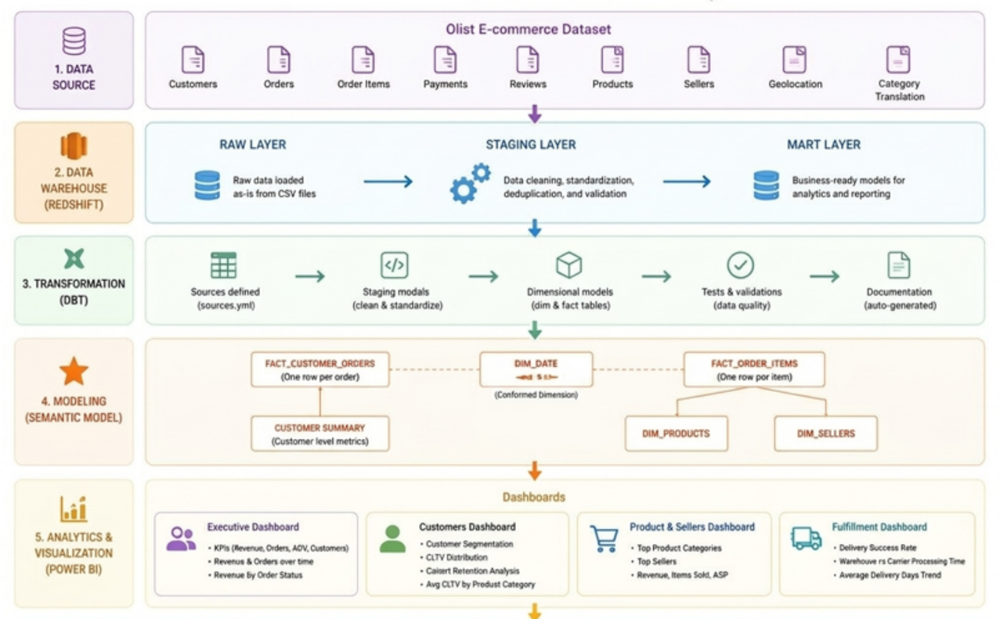
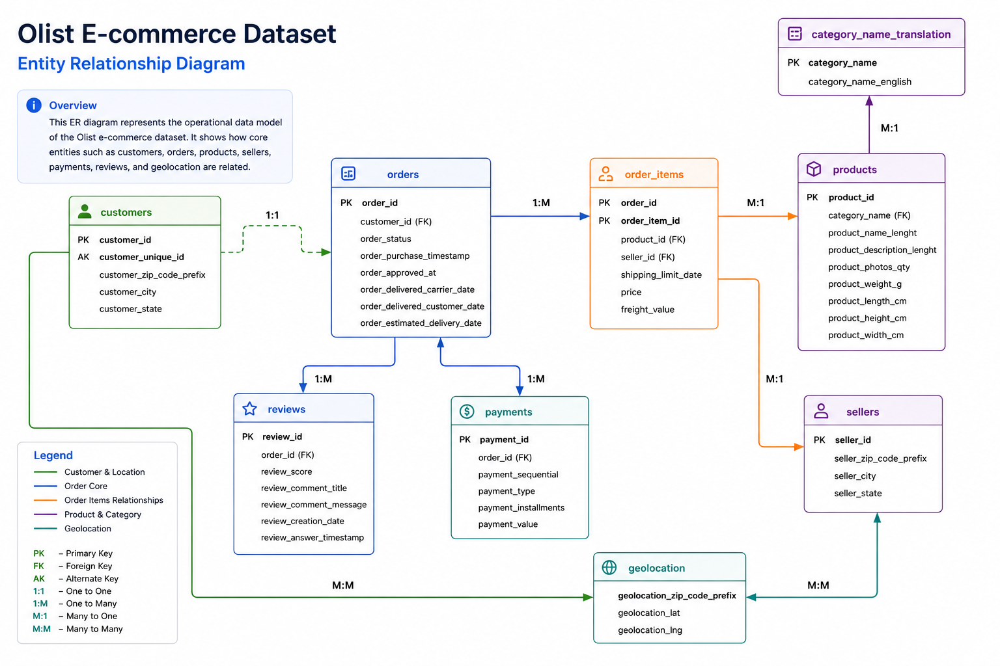
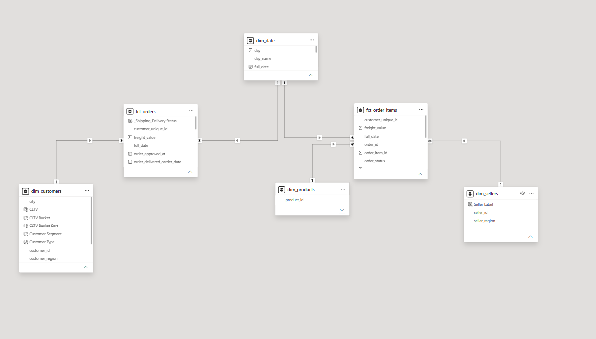
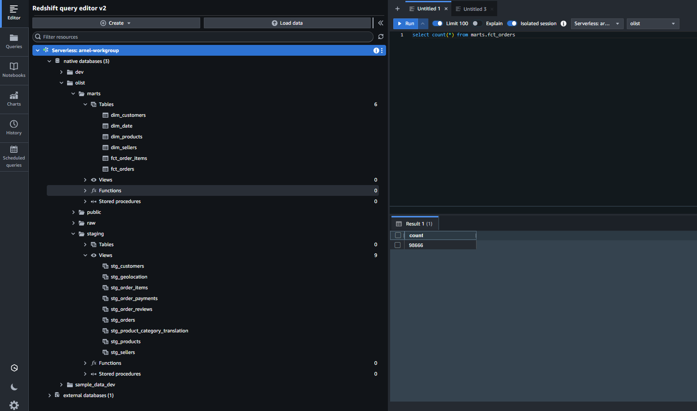
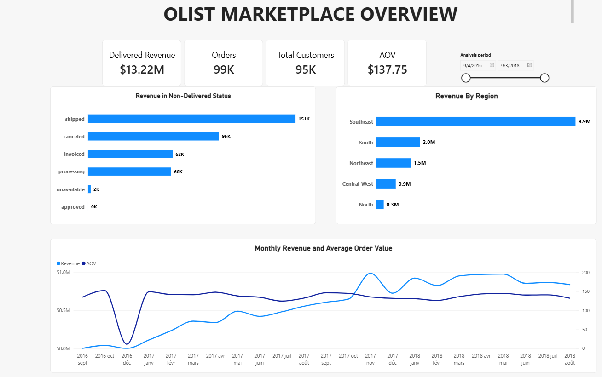
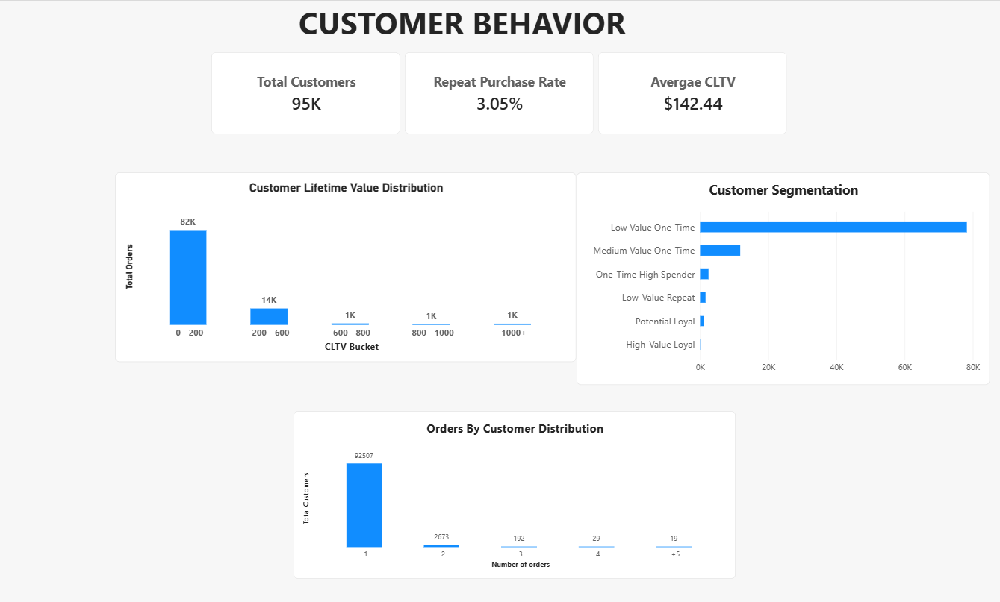
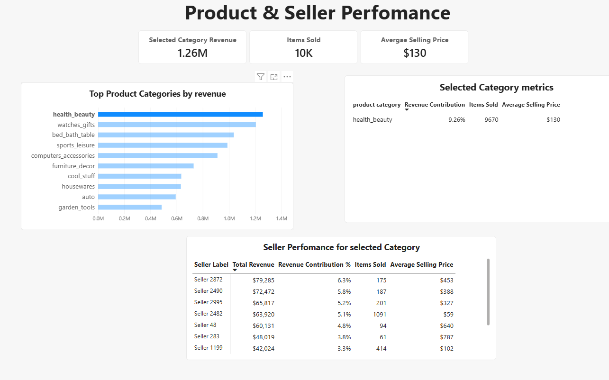

# Plateforme d'analyse e-commerce Olist

**Projet analytique de bout en bout \| Amazon S3 · Amazon Redshift · dbt
· Power BI**

> Projet de portfolio qui transforme les données e-commerce Olist en
> entrepôt analytique modélisé et en rapport Power BI pour explorer les
> ventes, les clients, les produits, les vendeurs et la performance des
> livraisons.

## Sommaire

-   [Contexte métier](#contexte-métier)
-   [Objectifs](#objectifs)
-   [Architecture](#architecture)
-   [Modélisation des données](#modélisation-des-données)
-   [Workflow de transformation dbt](#workflow-de-transformation-dbt)
-   [Rapport Power BI](#rapport-power-bi)
-   [Catalogue des indicateurs](#catalogue-des-indicateurs)

## Contexte métier

Le jeu de données Olist décrit une marketplace e-commerce brésilienne et
contient des informations sur les commandes, les clients, les produits,
les vendeurs, les paiements et les livraisons. Les données sources sont
réparties entre plusieurs fichiers liés entre eux, ce qui complique une
analyse cohérente sans modèle commun.

Ce projet organise les données sources dans un entrepôt analytique et
met à disposition des modèles orientés métier dans Power BI. Le rapport
permet d'explorer la performance commerciale, les comportements d'achat
des clients, la performance des catégories et des vendeurs, ainsi que
les résultats logistiques.

## Objectifs

1.  **Centraliser les données analytiques** dans un entrepôt plus simple
    à interroger et à maintenir.
2.  **Créer des transformations réutilisables** avec dbt au lieu de
    répéter la logique métier dans chaque rapport.
3.  **Construire un modèle dimensionnel** qui permet d'analyser les
    commandes et les lignes de commande.
4.  **Fournir des analyses métier** grâce à un rapport Power BI
    interactif.

## Architecture

Le flux général est le suivant :

1.  Les fichiers CSV sources d'Olist sont stockés dans Amazon S3.
2.  Les données sont mises à disposition dans Amazon Redshift pour les
    requêtes analytiques.
3.  dbt transforme les données sources en staging et ensuite en tables de faits et
    dimensions.
4.  Power BI exploite les modèles pour présenter les indicateurs métier
    et les pages interactives.

### Technologies

  Technologie       Rôle dans le projet
  ----------------- --------------------------------------------------------
  Amazon S3         Stockage des fichiers sources

  Amazon Redshift   Entrepôt de données cloud et moteur SQL analytique

  dbt               Transformations SQL, organisation des modèles et tests

  Power BI          Visualisation interactive et analyse métier

  Git / GitHub      Gestion des versions et documentation du projet

## Modélisation des données

Le projet adopte une approche dimensionnelle avec une table de faits au
niveau commande et une autre au niveau ligne de commande. La séparation
des granularités permet d'analyser les commandes sans perdre le détail
nécessaire à l'analyse des produits et des vendeurs.

### Diagramme entité-association (ERD)

### Modèle en étoile

Le modèle analytique s'appuie sur les modèles principaux suivants :

  Voici les données structurées sous forme de tableau Markdown :

| Modèle | Granularité | Objectif analytique principal |
| --- | --- | --- |
| `fct_orders` | Une ligne par `order_id` | Indicateurs au niveau commande, statut, client et livraison |
| `fct_order_items` | Une ligne par article d'une commande, identifiée par `order_id` + `order_item_id` | Analyse des produits et vendeurs au niveau article |
| `dim_customers` | Une ligne par `customer_unique_id` | Géographie, segmentation, comportement d'achat et valeur client |
| `dim_sellers` | Une ligne par `seller_id` | Comparaisons par vendeur et par région |
| `dim_products` | Une ligne par produit | Analyse des produits et catégories |
| `dim_date` | Une ligne par date calendaire | Attributs de calendrier standardisés pour l'analyse temporelle |

Les relations et les clés exactes doivent correspondre aux modèles dbt
actuels et au modèle sémantique Power BI. L'analyse des vendeurs
s'appuie notamment sur `fct_order_items`, où les identifiants vendeur et
produit sont disponibles au niveau de l'article.

### Tables dans Redshift

## Workflow de transformation dbt

dbt organise les transformations dans des modèles SQL maintenables et
explicite les dépendances avec `ref()` et `source()`.

L'approche du projet comprend :

-   **Modèles de staging** pour standardiser les noms de colonnes et les
    types issus des sources.
-   **Modèles de dimensions** pour exposer des attributs descriptifs
    orientés métier.
-   **Modèles de faits** pour préserver la granularité adaptée aux
    analyses.
-   **Macros réutilisables**, notamment pour déduire une région à partir
    du code de l'État.
-   **Tests et documentation** pour valider et expliquer les modèles de
    données.

## Rapport Power BI

Le rapport comprend quatre pages. Les visuels ci-dessous sont des
emplacements réservés à remplacer par des captures du fichier `.pbix`
final.

### 1. Overview --- Vue d'ensemble

La page d'accueil présente les indicateurs principaux et donne une vue
globale de l'activité commerciale. Elle comprend notamment :

-   Les cartes Delivered Revenue, Total Orders, Total Customers et
    Average Order Value (AOV).
-   Le revenu par région client.
-   L'évolution mensuelle du revenu et du panier moyen.
-   Le revenu associé aux commandes dont le statut n'est pas livré.

### 2. Customers --- Clients

Cette page explore les comportements d'achat et la valeur client. Les
visuels comprennent :

-   Le nombre total de clients.
-   Le taux de réachat.
-   La mesure de valeur client moyenne (CLTV).
-   La distribution de la valeur client par tranche CLTV.
-   La segmentation des clients.
-   La répartition des clients selon leur nombre de commandes.

### 3. Products & Sellers --- Produits et vendeurs

Cette page permet d'analyser la performance des produits, des catégories
et des vendeurs. Les visuels comprennent :

-   Le revenu total, le nombre de produits vendus et le prix de vente
    moyen.
-   Les principales catégories de produits par revenu.
-   Les indicateurs de la catégorie sélectionnée : part du revenu,
    produits vendus et prix de vente moyen.
-   La performance des vendeurs pour la catégorie sélectionnée : revenu,
    part du revenu, produits vendus et prix de vente moyen.

### 4. Fulfillment & Logistics --- Préparation et logistique

Cette page se concentre sur la préparation des commandes et les
résultats de livraison. Les visuels comprennent :

-   La durée moyenne de livraison.
-   La durée moyenne de préparation en entrepôt.
-   La durée moyenne de transport par le transporteur.
-   Le taux de livraison en retard.
-   La comparaison temporelle entre durée de livraison estimée et
    réelle.
-   Le délai de livraison par région client.
-   La répartition entre livraisons à l'heure et en retard.

## Catalogue des indicateurs

| Domaine | Indicateur / Visuel | Question métier |
| --- | --- | --- |
| **Vue d'ensemble** | Delivered Revenue | Quel revenu est associé aux commandes livrées ? |
| **Vue d'ensemble** | Total Orders | Combien de commandes sont présentes dans le contexte de filtres courant ? |
| **Vue d'ensemble** | Total Customers | Combien de clients sont présents dans le contexte de filtres courant ? |
| **Vue d'ensemble** | AOV / Delivered AOV | Quelle est la valeur moyenne d'une commande ? |
| **Vue d'ensemble** | Revenue by Region | Quelles régions clients contribuent le plus au revenu ? |
| **Vue d'ensemble** | Monthly Revenue and AOV | Comment le revenu et le panier moyen évoluent-ils dans le temps ? |
| **Vue d'ensemble** | Revenue in Non-Delivered Status | Quel revenu est associé aux commandes qui ne sont pas livrées ? |
| **Clients** | Repeat Purchase Rate | Quelle part des clients passe plus d'une commande ? |
| **Clients** | Average CLTV | Valeur/Montant total des commandes déjà passées par un client. |
| **Clients** | CLTV Bucket | Comment la valeur client se répartit-elle entre les tranches définies dans le rapport ? |
| **Clients** | Customer Segmentation | Comment les clients sont-ils regroupés selon leur comportement ou leur valeur ? |
| **Clients** | Orders by Customer Distribution | Comment les clients se répartissent-ils selon leur nombre de commandes ? |
| **Produits** | Total Revenue | Quelles catégories ou quels produits contribuent le plus au revenu ? |
| **Produits** | Total Products Sold | Combien d'articles vendus sont comptabilisés par la mesure ? |
| **Produits** | Average Selling Price | Quel est le prix moyen des articles dans le contexte de filtres courant ? |
| **Produits** | Revenue Contribution % | Quelle part du revenu pertinent provient d'une catégorie ou d'un vendeur ? |
| **Vendeurs** | Seller Performance for Selected Category | Quels vendeurs contribuent le plus à la performance de la catégorie sélectionnée ? |
| **Logistique** | Average Delivery Days | Quelle est la durée moyenne de livraison ? |
| **Logistique** | Average Warehouse Processing Days | Combien de temps faut-il en moyenne pour préparer une commande en entrepôt ? |
| **Logistique** | Average Carrier Transit Days | Quelle est la durée moyenne du transport par le transporteur ? |
| **Logistique** | Late Delivery Rate | Quelle proportion des commandes est classée en retard (fonction de la date de livraison estimée) ? |
| **Logistique** | Estimated vs Actual Delivery Time | Comment la durée réelle se compare-t-elle à la durée estimée ? |
| **Logistique** | Delivery Time by Region | Comment la durée moyenne de livraison varie-t-elle selon la région client ? |
| **Logistique** | Delivery Status | Quelle part des commandes est classée à l'heure ou en retard ? |

### Comportement des filtres

Cette capture illustre le caractère interactif du rapport Power BI : la sélection d'une période, d'une région ou d'une catégorie peut modifier les indicateurs et les graphiques concernés. Les interactions exactes dépendent des filtres et des paramètres configurés dans le rapport.

---

---

**Projet réalisé par Arnel Kapoel Fokou**
